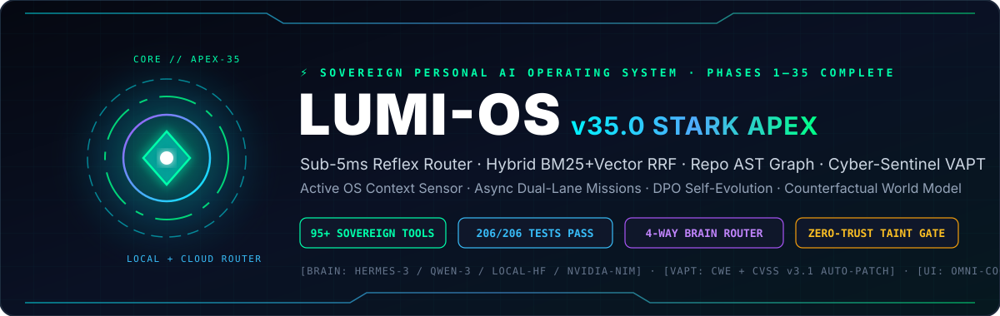
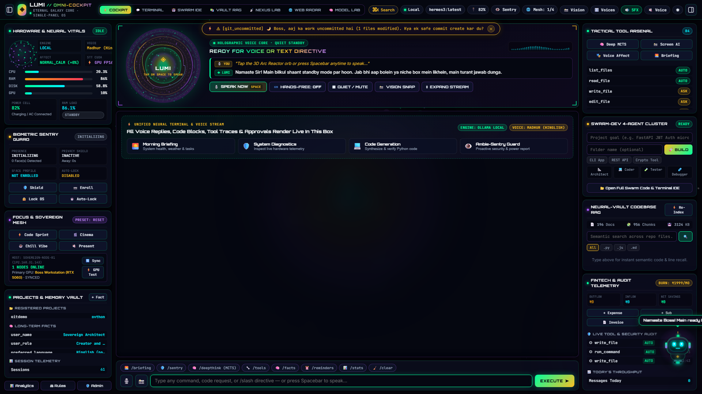
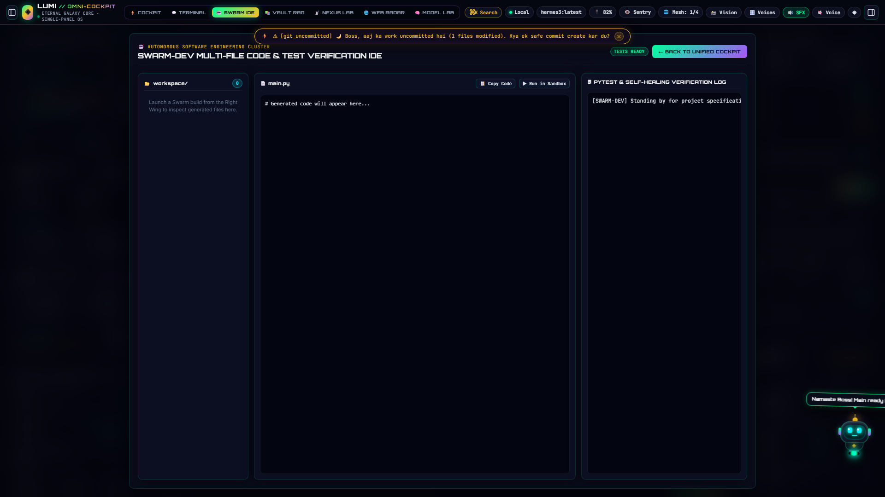
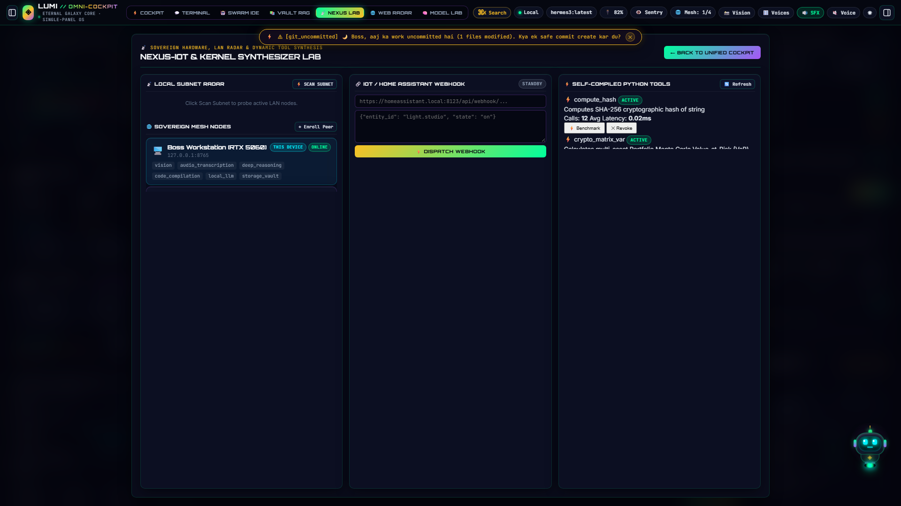
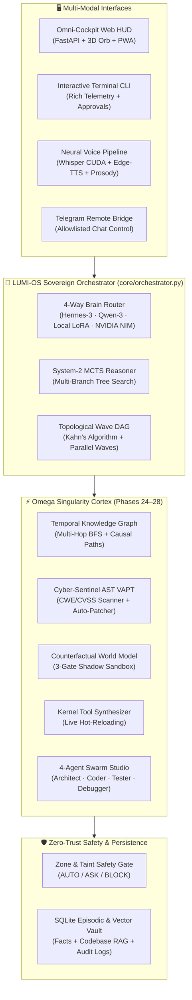

<div align="center">



<br />

[](https://github.com/Ketan65/LUMI-OS)
[](https://www.python.org/)
[](tests/)
[](tools/)
[](SECURITY.md)
[](LICENSE)

<p align="center">
  <b>A Local-First, Sovereign Personal AI Operating System & Autonomous Engineering Cortex</b><br />
  <i>Combining a 4-Way LLM Brain Router, Multi-Agent Swarm IDE, AST Taint VAPT Auto-Patcher, Counterfactual World-Model Sandbox, Topological Wave DAG Executor, Temporal Knowledge Graph, and Real-Time Neural Voice Cockpit.</i>
</p>

<p align="center">
  <a href="#-omni-cockpit-visual-showcase"><b>🖥️ Cockpit Showcase</b></a> ·
  <a href="#-omega-singularity-engines-phases-2428"><b>⚡ Omega Singularity</b></a> ·
  <a href="#-system-architecture"><b>🧬 Architecture</b></a> ·
  <a href="#-28-phase-capability-matrix"><b>🚀 28 Phases</b></a> ·
  <a href="#-zero-trust-security--taint-gate"><b>🛡️ Security Gate</b></a> ·
  <a href="#-60-second-quickstart"><b>⚙️ Quickstart</b></a>
</p>

</div>

---

## 🖥️ Omni-Cockpit Visual Showcase

LUMI-OS features a **Single-Panel Cyberpunk Omni-Cockpit (`http://127.0.0.1:8765`)** with a 60 FPS 3D Arc Reactor voice orb, live hardware vitals, biometric presence guard, 4-agent Swarm IDE, and an interactive desktop mascot (**Chotu LUMI**).

<div align="center">
  
  <p><i><b>Figure 1:</b> LUMI-OS Unified Omni-Cockpit — 3D Neural Voice Orb, Hardware Telemetry, Biometric Sentry, 84-Tool Tactical Arsenal, and Chotu LUMI Cyber Mascot.</i></p>
</div>

| 🤖 Swarm-Dev 4-Agent Engineering Studio | 🛰️ Nexus-IoT & Kernel Synthesizer Lab |
| :---: | :---: |
|  |  |
| *Autonomous Architect → Coder → Tester → Debugger pipeline with real-time `pytest` self-healing.* | *LAN Subnet Radar, Sovereign GPU Mesh Nodes, Home Assistant Webhooks & Self-Compiled Python Tools.* |

---

## ⚡ Omega Singularity Engines (Phases 24–28)

LUMI-OS goes beyond conversational wrappers by integrating **five deterministic + neural cognitive engines** directly into the orchestrator loop:

### 1. 🧠 Temporal Knowledge Graph & Episodic Memory Palace (`Phase 24`)
- **Modules:** [`core/cognitive_graph.py`](core/cognitive_graph.py) · [`tools/cognitive_graph.py`](tools/cognitive_graph.py)
- **Capabilities:** Extracts structured subject-predicate-object triples from conversations and technical documents into SQLite (`kg_nodes`, `kg_edges`) with temporal validity windows and confidence decay.
- **Algorithms:** Multi-hop Breadth-First Search (`query_neighborhood`), shortest causal chain discovery (`find_causal_path`), and live ecosystem topology summaries (`/graph`).

### 2. 🛡️ Cyber-Sentinel AST Taint & VAPT Auto-Patcher (`Phase 25`)
- **Modules:** [`core/cyber_sentinel.py`](core/cyber_sentinel.py) · [`tools/cyber_sentinel.py`](tools/cyber_sentinel.py)
- **Capabilities:** Performs deep Abstract Syntax Tree (AST) intraprocedural taint tracking (`source → sink`), regex structural auditing, and Shannon entropy secret scanning.
- **Coverage & Auto-Remediation:** Detects **CWE-78** (OS Command Injection), **CWE-89** (SQL Injection), **CWE-94** (`eval`/`exec` Code Injection), **CWE-502** (Unsafe `pickle` Deserialization), **CWE-327** (Weak Cryptography), and **CWE-798** (Hardcoded Credentials) with **CVSS v3.1** scoring. Automatically synthesizes hardened patches with unified diffs and re-verifies zero-CWE compliance (`/vapt`).

### 3. 🕸️ Topological Parallel Wave DAG Executor (`Phase 26`)
- **Modules:** [`core/dag_executor.py`](core/dag_executor.py) · [`tools/dag_executor.py`](tools/dag_executor.py)
- **Capabilities:** Compiles complex multi-objective missions into a Directed Acyclic Graph (DAG) of tool & reasoning nodes, validates acyclicity via **Kahn's Algorithm**, and groups independent tasks into concurrent execution waves (`ThreadPoolExecutor`).
- **Dynamic Context Piping:** Downstream nodes automatically inherit upstream outputs via `$node_id.output` interpolation with automatic **Reflexion self-healing** on transient failures (`/dag`).

### 4. 🌍 Counterfactual Pre-Flight World-Model Simulator (`Phase 27`)
- **Modules:** [`core/world_model.py`](core/world_model.py) · [`tools/world_model.py`](tools/world_model.py)
- **Capabilities:** Never mutates production files blindly. Clones the target module into an isolated temporary shadow sandbox and validates candidate mutations across **3 Verification Gates**:
  1. **Gate 1 (AST Syntax & Import Integrity)**
  2. **Gate 2 (Cyber-Sentinel Zero-New-CWE Security Audit)**
  3. **Gate 3 (Automated `unittest`/`pytest` Regression Execution)**
- Only when all 3 gates pass (`COMMIT_APPROVED`) does LUMI atomically swap the file while archiving a rollback snapshot in `.shadow_backups/` (`/simulate`).

### 5. 🔨 Natural-Language Autonomous Tool Auto-Forging (`Phase 28`)
- **Modules:** [`core/synthesizer.py`](core/synthesizer.py) · [`tools/synthesizer.py`](tools/synthesizer.py)
- **Capabilities:** Given only a tool name and natural-language specification (`auto_forge_tool`), LUMI synthesizes the Python implementation, validates it against the AST safety sandbox, runs automated smoke tests, persists it to `data/dynamic_tools/`, and **hot-injects** it into the live `ToolRegistry` without restarting.

---

## 🧬 System Architecture



---

## 🔀 4-Way Sovereign Brain Router

Switch inference engines instantaneously at runtime without restarting via `/model`:

| Slash Command | Active Engine | Target Use Case |
| :--- | :--- | :--- |
| `/model hermes` | **Ollama `hermes3:latest` (8B)** | Fast agentic tool calling, uncensored technical reasoning, low-latency cockpit control |
| `/model qwen` | **Ollama `qwen3:8b`** | Deep code synthesis, structured JSON generation, mathematical & algorithmic analysis |
| `/model local` | **HuggingFace Local + LoRA Adapter** | Offline custom fine-tuned weights (`models/lumi-finetuned-merged`) |
| `/model cloud` | **NVIDIA NIM (`Llama-3.3-70B-Instruct`)** | Heavy cloud fallback for massive context synthesis (API key via `NVIDIA_API_KEY` env var) |

---

## 🚀 28-Phase Capability Matrix

<details open>
<summary><b>Click to expand all 28 Architectural Phases of LUMI-OS</b></summary>

| Phase | Subsystem | Core Modules | Status |
| :---: | :--- | :--- | :---: |
| **1–4** | **Core Brain, Memory & Zone Safety Gate** | `brain/router.py`, `memory/store.py`, `safety/gate.py` | ✅ Verified |
| **5–8** | **Reflection, Skill Distillation & Desktop Control** | `evolution/reflect.py`, `evolution/skills.py`, `tools/desktop.py` | ✅ Verified |
| **9–12** | **Neural Voice (Whisper STT + Edge-TTS) & Vision** | `voice/pipeline.py`, `tools/vision.py`, `interface/telegram_bot.py` | ✅ Verified |
| **13** | **Ambie-Sentry Zero-Prompt Hardware Guardian** | `safety/sentry.py`, `tools/sentry.py` | ✅ Verified |
| **14** | **Neural-Vault Semantic Codebase RAG** | `core/vault.py`, `tools/vault.py` | ✅ Verified |
| **15** | **Swarm-Dev 4-Agent Autonomous Software Studio** | `core/swarm.py`, `tools/swarm.py` | ✅ Verified |
| **16** | **Nexus-IoT LAN Radar & Workstation Focus Presets** | `core/nexus.py`, `tools/nexus.py` | ✅ Verified |
| **17** | **Kernel-Synthesis Dynamic Runtime Tool Compiler** | `core/synthesizer.py`, `tools/synthesizer.py` | ✅ Verified |
| **18** | **System-2 MCTS Reasoner, Biometrics & FinTech Oracle** | `brain/mcts_reasoner.py`, `safety/biometrics.py`, `finance/oracle.py` | ✅ Verified |
| **19–21** | **Web Operator, Deep Research & Proactive Assistant** | `core/web_operator.py`, `core/researcher.py`, `core/proactive_assistant.py` | ✅ Verified |
| **22–23** | **Unified Omni-Cockpit HUD, Chotu Mascot & LoRA Lab** | `web/index.html`, `web/app.js`, `scripts/set_wise_trainer.py` | ✅ Verified |
| **24** | **Temporal Knowledge Graph & Episodic Memory Palace** | `core/cognitive_graph.py`, `tools/cognitive_graph.py` | ✅ Verified |
| **25** | **Cyber-Sentinel AST Taint & VAPT Auto-Patcher** | `core/cyber_sentinel.py`, `tools/cyber_sentinel.py` | ✅ Verified |
| **26** | **Topological Parallel Wave DAG Executor** | `core/dag_executor.py`, `tools/dag_executor.py` | ✅ Verified |
| **27** | **Counterfactual Pre-Flight World-Model Simulator** | `core/world_model.py`, `tools/world_model.py` | ✅ Verified |
| **28** | **Natural-Language Autonomous Tool Auto-Forging** | `core/synthesizer.py`, `web/server.py` (`/api/omega/*`) | ✅ Verified |

</details>

---

## 🛡️ Zero-Trust Security & Taint Gate

Every tool invocation passes through [`safety/gate.py`](safety/gate.py) before execution:

| Filesystem / System Zone | Read / List | Write / Mutate | Delete / Execute |
| :--- | :---: | :---: | :---: |
| **`./workspace/` (Sandbox)** | `AUTO` | `AUTO` *(Escalates to `ASK` if turn is tainted)* | `ASK` |
| **LUMI-OS Core (`core/`, `safety/`, `brain/`, `config.yaml`)** | `AUTO` | **🚫 `BLOCK` (Immutable Self-Protection)** | **🚫 `BLOCK`** |
| **Registered Projects (`register_project`)** | `AUTO` | `ASK` (Explicit User Approval Required) | `ASK` |
| **Outside `allowed_paths` / OS System Directories** | **🚫 `BLOCK`** | **🚫 `BLOCK`** | **🚫 `BLOCK`** |

- **Prompt-Injection Taint Tracking:** Reading external web pages or untrusted files marks the turn as `tainted=True` in [`core/orchestrator.py`](core/orchestrator.py), automatically preventing silent `AUTO` side effects.
- **OPSEC Privacy Isolation:** Personal identity settings live strictly in git-ignored `config/identity.local.json` (falling back to the generic [`config/identity.json`](config/identity.json) template).

---

## ⚙️ 60-Second Quickstart

### 1. Clone & Install Dependencies
```powershell
git clone https://github.com/Ketan65/LUMI-OS.git
cd LUMI-OS
pip install -r requirements.txt
```

### 2. Pull Local Ollama Models (Recommended)
```powershell
ollama pull hermes3:latest
ollama pull qwen3:8b
```

### 3. Launch LUMI-OS
```powershell
# Launch the Cyberpunk Omni-Cockpit Web UI -> http://127.0.0.1:8765
python main.py --web

# Or use the one-click Windows launcher
.\start_lumi.bat

# Or launch in Interactive Terminal CLI mode
python main.py
```

*(Optional)* Configure cloud fallback or Telegram in environment variables (never stored in plaintext config):
```powershell
setx NVIDIA_API_KEY "nvapi-..."
setx TELEGRAM_BOT_TOKEN "..."
```

---

## ⌨️ Tactical Slash Commands & REST API

### Interactive Slash Directives
| Command | Action |
| :--- | :--- |
| `/vapt <file_or_dir>` | Run Cyber-Sentinel AST taint scan, CWE/CVSS v3.1 report, or auto-remediation |
| `/graph <entity_or_query>` | Query the Temporal Knowledge Graph neighborhood or ecosystem topology |
| `/dag <mission_goal>` | Decompose and execute a multi-step mission via the Topological Wave DAG Executor |
| `/simulate <file> :: <goal>` | Run a 3-gate Counterfactual World-Model simulation before committing changes |
| `/deepthink <problem>` | Invoke System-2 Monte Carlo Tree Search (MCTS) multi-branch reasoning |
| `/model hermes\|qwen\|local\|cloud` | Hot-switch the active LLM inference engine at runtime |
| `/briefing` | Generate an executive daily standup digest & hardware telemetry summary |
| `/sentry` | Inspect Ambie-Sentry hardware vitals, battery, RAM load, and git autosave status |

### Key REST API Endpoints (`http://127.0.0.1:8765`)
- `POST /api/chat` — Primary conversational & agentic tool-execution endpoint
- `GET  /api/omega/status` — Live telemetry across all Omega Singularity subsystems
- `POST /api/omega/vapt` — Trigger AST taint analysis, workspace surface audit, or auto-patching
- `POST /api/omega/graph` — Ingest knowledge triples, query BFS neighborhoods, or trace causal paths
- `POST /api/omega/dag` — Execute parallel wave DAG workflows
- `POST /api/omega/simulate` — Run pre-flight counterfactual sandbox verification & profiling

---

## 🧪 Verification & Test Suite

LUMI-OS ships with a comprehensive **201-test verification gauntlet** covering prompt-injection tainting, zone safety gates, AST VAPT auto-patching, MCTS reasoning, multi-agent Swarm synthesis, and DAG wave execution:

```powershell
pip install -r requirements-dev.txt
python -m pytest tests -q
# -> 201 passed
```

---

## 📂 Repository Architecture

```text
LUMI-OS/
├── brain/                  # 4-Way LLM Router, Ollama, Local HF LoRA, NVIDIA Cloud & MCTS Reasoner
├── config/                 # Model configurations, LoRA hyperparameters & OPSEC-safe identity template
├── core/                   # Orchestrator, Cyber-Sentinel VAPT, World Model, Wave DAG, Knowledge Graph, Swarm
├── docs/assets/            # SVG Hero Banners & Sanitized Cockpit Screenshots
├── evolution/              # Self-reflection loop, Digital Shadow standups & YAML skill distillation
├── finance/                # Local SQLite FinTech burn-rate & Monte Carlo VaR oracle
├── interface/              # Rich Terminal CLI & allowlisted Telegram bridge
├── memory/                 # SQLite episodic store, working memory & semantic codebase recall
├── mesh/                   # Sovereign LAN GPU mesh discovery & peer dispatch
├── safety/                 # Zero-Trust file/command gate, taint tracker, biometrics & audit logs
├── scripts/                # LoRA fine-tuning pipeline, GGUF export & live verification harnesses
├── tests/                  # 201 unit, security, injection & Omega Singularity integration tests
├── tools/                  # 84 sovereign tools (VAPT, DAG, World Model, Graph, Swarm, Vision, GUI)
├── voice/                  # Local Whisper CUDA STT, Edge-TTS neural prosody & wake-word pipeline
├── web/                    # FastAPI server + Single-Panel Cyberpunk Omni-Cockpit HUD
└── main.py                 # Unified CLI / Web / Voice entrypoint
```

<div align="center">
  <br />
  <b>Built with Sovereign Precision · 100% Local-First · Zero Telemetry Leakage</b>
</div>
